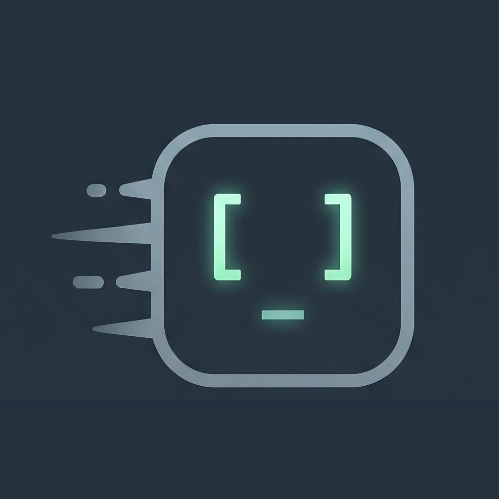
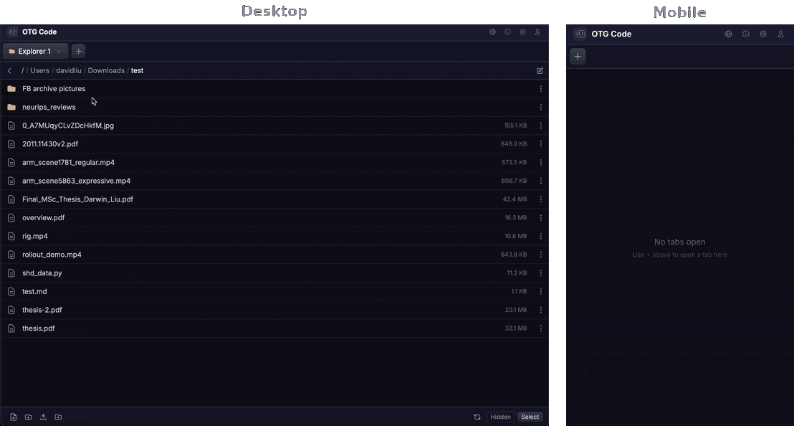

<p align="center">
  
</p>

<h1 align="center">OTG Code</h1>
<p align="center"><em>On-The-Go Code — a mobile-first, terminal-focused development environment in the browser</em></p>

<p align="center">Work on your VPS or home machine from anywhere — phone, tablet, or desktop — with zero client-side installation. A mobile-optimised terminal built for coding CLIs, with file explorer, code editor, and localhost proxy — all in a single browser tab, accessible via a single Cloudflare Quick Tunnel.</p>

<p align="center">
  
  <a href="https://github.com/davindicode/otgcode/actions/workflows/ci.yml"></a>
  
  <a href="LICENSE"></a>
  = 20.19">
  
  
  
  
</p>

<p align="center">
  <a href="public/videos/demo.gif" title="OTG Code on a desktop browser and on a phone"></a>
</p>

## Features

### Mobile-native UX for terminal workflows

- **Task-specific action keyboards** under every terminal — `main` for the shell
  itself, one per coding CLI (claude, codex, opencode) read from what that CLI
  actually binds, `git`, your own saved commands, and a directory picker that
  knows where the shell really is.
- **tmux session controls as buttons** — windows, panes and copy mode, so
  driving tmux takes no prefix chord. Only on a tmux tab, so tmux keys can never
  land in a plain shell.
- **A dedicated text input box** for writing a line out in full — a prompt, a
  commit message, a path — with Send beside it. It goes in as a *paste*, so a
  TUI reads it as text rather than a burst of keys it might have bindings for.
- **Split panes on a wide screen** — one pane or two side by side, each with its
  own tab strip, its own `+` and its own active tab; drag a tab across to move
  it. A narrow screen draws one pane at a time and remembers which one it was
  showing.

### Native tab interfaces

| | |
|---|---|
| **Terminal** | Your shell, in a pty on the host. It survives a minute without a connection, so a drop and a reconnect cost you nothing |
| **tmux** | A tmux session — the tab is a client of it, so a dropped connection re-attaches to the same session |
| **Explorer** | A file browser. Pick a file and it opens in a viewer or editor tab of its own: Monaco for code, markdown with KaTeX equations, notebooks, PDFs, images, video and audio |

### Throughout

- **Light and dark** — one token set drives the UI, the terminal's ANSI palette
  and the editor's theme together, resolved server-side so a reload paints the
  right theme immediately.
- **Localhost previews** through a built-in `/proxy/:port`, over the same tunnel
  — HTTP and WebSockets, so a dev server with HMR works.
- **Password-protected by default**, enforced server-side on every request, the
  proxy and the terminal socket. One device holds the session at a time.

Full feature list, architecture and troubleshooting: **[DOCS.md](DOCS.md)**.
Every release is described in [CHANGELOG.md](CHANGELOG.md).

## Requirements

- **Linux, macOS, or Windows via [WSL2](https://learn.microsoft.com/windows/wsl/install)** — the terminal rests on a Unix pty
- **Node.js** 20.19 or newer, and **pnpm** 10 or newer (`npm install -g pnpm`)
- **A C/C++ toolchain and Python 3 on Linux** — `node-pty` compiles there
  (`sudo apt install -y build-essential python3` on Debian/Ubuntu). macOS needs
  nothing extra

`./start.sh` checks all of this up front and names the command to fix it, rather
than failing later at the first terminal you open. See
[Platforms](DOCS.md#platforms) for the other distros and the WSL2 walkthrough.

## Quick start

```bash
git clone https://github.com/davindicode/otgcode.git
cd otgcode

# Optional: port, shell and starting directory
cp .env.example .env

# Install, build, start, and open a Cloudflare tunnel
./start.sh

# ...or on another port
./start.sh --port 8080
```

`start.sh` installs dependencies, builds the app, starts the server and opens a
Cloudflare Quick Tunnel, printing a public URL you can open on any device with
the LAN addresses beside it. First start asks you to set an access password
before the app opens.

Tunnel URL not resolving? [Set your DNS to 1.1.1.1](DOCS.md#tunnel-url-not-resolving-set-your-dns-to-1111).
`pnpm dev` runs the same app with HMR if you are working on OTG Code itself.

> [!WARNING]
> The tunnel URL reaches a shell on your host, as the user that launched OTG
> Code, with read/write access to that user's files. **With the access password
> on, that is what stands in the way** — enforced server-side on every request,
> the localhost proxy and the terminal socket, not just in the UI.
>
> **Without it, the URL is the only thing protecting that shell, so keep it
> private.** You can turn a password on at any time from the Settings cog.
>
> Locked out? Set `passwordEnabled` to `false` in `~/.otgcode/config.json` on
> the host and restart.

## Docs

| | |
|---|---|
| [DOCS.md](DOCS.md) | Features in full, platforms, scripts, architecture, troubleshooting, known limitations |
| [CHANGELOG.md](CHANGELOG.md) | What changed in each release |
| [CONTRIBUTING.md](CONTRIBUTING.md) | Dev setup, conventions, PR workflow |

## License

[MIT](LICENSE)
