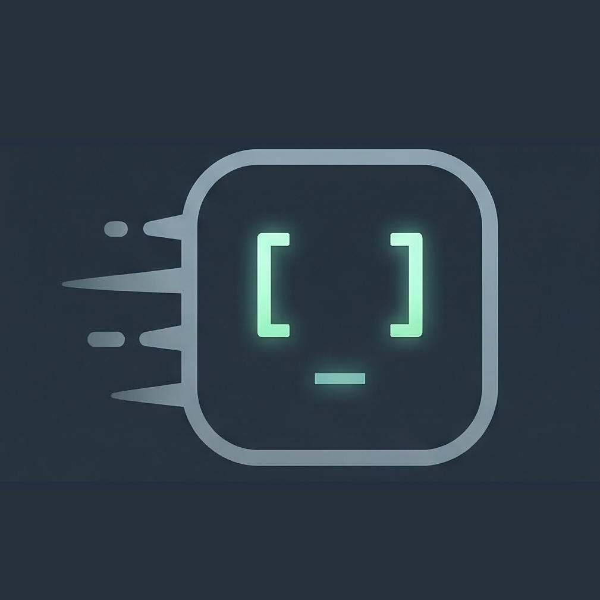
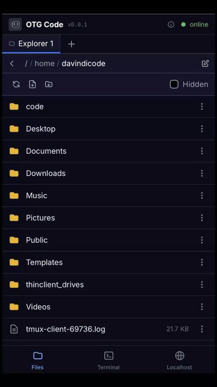
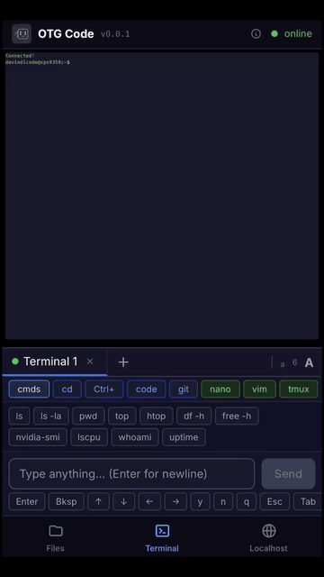
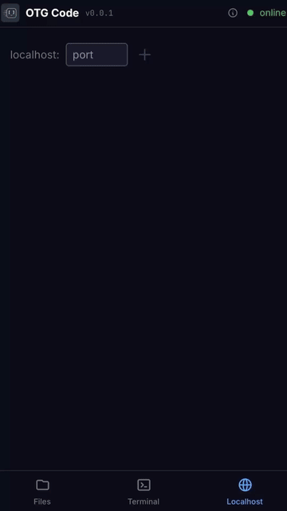

<p align="center">
  
</p>

<h1 align="center">OTG Code</h1>
<p align="center"><em>On-The-Go Code — a mobile-first, terminal-focused development environment in the browser</em></p>

<p align="center">Work on your VPS or home machine from anywhere — phone, tablet, or desktop — with zero client-side installation. A mobile-optimised terminal built for coding CLIs, with file explorer, code editor, and localhost proxy — all in a single browser tab, accessible via a single Cloudflare Quick Tunnel.</p>

<p align="center">
  
  
  <a href="LICENSE"></a>
  = 20.19">
  
  
  
  
</p>

Every release is described in [CHANGELOG.md](CHANGELOG.md).

## Features

<!-- Product demo previews (GIFs) -> use table for consistent GitHub layout -->
<table align="center">
  <tr>
    <td align="center" style="padding:8px">
    <a href="public/videos/demo_explorer.gif" title="Open Explorer GIF"></a>
      <div style="font-size:13px;color:#555;margin-top:8px;">File explorer</div>
    </td>
    <td align="center" style="padding:8px">
      <a href="public/videos/demo_terminal.gif" title="Open Terminal GIF"></a>
      <div style="font-size:13px;color:#555;margin-top:8px;">Terminal interface</div>
    </td>
    <td align="center" style="padding:8px">
      <a href="public/videos/demo_localhost.gif" title="Open Localhost GIF"></a>
      <div style="font-size:13px;color:#555;margin-top:8px;">Localhost preview</div>
    </td>
  </tr>
</table>


Tabs in one strip, VS Code style. Tabs come in four kinds — **Terminal**, **tmux session**, **Explorer**, and the **viewer/editor** tabs that open when you pick a file in an explorer. A tmux tab *is* its session: it runs tmux rather than a shell, so a reconnect re-attaches instead of dropping you into a shell outside it. `+` asks which kind to create; file tabs are spawned by the explorer, so an explorer always stays a file browser, and a file opens next to the explorer it came from. **Drag the selected tab to reorder it**; dragging any other tab slides the whole strip, for when there are more tabs than fit. On a phone the selected tab needs a hold first, so a swipe still scrolls.

On a wide screen you can **split the view in two**, from Settings → Appearance: a file on the left and a terminal on the right, with a divider to drag (double-click it to even the panes up). Each pane has its own tab strip, its own `+` and its own active tab, and a tab moves across by being dragged onto the other strip. On a phone — or any screen under 900px or taller than it is wide — one pane is drawn and every tab stays reachable from the same strip, so the split costs nothing on mobile and is waiting when you dock.

Each tab's controls sit in the bottom bar and change with the tab. Localhost previews, system info, settings and your account live in popups under the header icons. Every tab stays mounted in the DOM with CSS visibility toggling, preserving terminal state and WebSocket connections across switches. A fresh start opens on an empty board rather than a shell you did not ask for. Everything routes through a single Cloudflare Quick Tunnel.

Install it to a home screen and it runs standalone like a native app; the layout, open tabs and your preferences are saved on the host, so a refresh or a reconnect from another device puts you back where you were.

**One device at a time.** The open tabs and their terminals are a single workspace on the host, so a second device is told who holds the session and waits for it rather than taking it — nothing reachable from the tunnel URL can pull a live terminal away from whoever is using it. Signing out, closing the tab or letting the session expire frees it. tmux sessions keep running either way, which is what to use for two devices on one terminal.

### Terminal & tmux
- Terminal tabs run your shell. **tmux tabs run tmux** (`tmux new -A`), so a dropped phone or a closed laptop re-attaches to the same session instead of landing in a fresh shell beside it
- Picking **tmux session** from `+` opens a picker: attach to a running session, start a new one, or kill one. Closing a tmux tab detaches; the session keeps running
- **Renaming a tmux tab renames the session.** The tab title, tmux itself, and the name a reconnect attaches by are one value, so the picker and the strip can never disagree
- **Composer tabs** under the terminal, changing with the tab they belong to:
  - **keyboard** — the input and send, over one row of keys that never grows. Any row longer than the screen can be dragged sideways, or scrolled with a wheel on a desktop. A mode picks what those keys are: `main` for the terminal itself, a keyboard per coding CLI (claude, codex, opencode), or git
    - **main** carries a key set — nav, numbers, letters, function, symbols — and a sticky modifier beside it: Shift, Ctrl, Ctrl+Shift, Alt or Alt+Shift
    - a **CLI** keyboard leads with Enter, then Bksp and the arrows for its prompts, then its own shortcuts, a bare launch button, and **slash commands you can add per CLI**, kept separately for each
    - **git** — status, log, diff, add, fetch, pull, push, stash, branch, commit with a message, and `user.name` / `user.email` setup
  - **commands** — common shell commands (ls, top, df, free, nvidia-smi…), plus **your own**: add, edit and remove, saved on the host
  - **navigate** — directory picker with server-side CWD detection, so it follows you inside tmux too
  - **tmux session** — in-session controls, only on a tmux tab, so tmux keys can never be typed into a plain shell: windows (new, next, prev, last, rename, kill, list, and any index by number), panes (split, select, cycle, zoom, kill, layout) and copy mode
- **Closing a tab asks first** only where it costs something — a terminal takes its processes and scrollback with it, a file with unsaved edits says so. A tmux tab closes without asking: the session keeps running on the host
- **Every tab keeps its own composer state** — switching tabs leaves your half-typed command, open group and chosen CLI where they were, rather than carrying them to another session
- System info popup with OS, kernel, CPU, memory, GPU, and connection latency to the host
- Tool version detection (tmux, claude, codex, opencode)

### File Explorer
- Explorer tabs (renamable), breadcrumb and editable path navigation
- Create, rename, delete files and folders; multi-select for bulk download or delete; file info dialog; hidden files toggle
- **Move mode** — pick an entry, browse to where it belongs, drop it there. Refuses to overwrite, to move a folder into itself, or to move something onto where it already is, and copies instead of renaming across filesystems
- Context menu (right-click / long-press), selectable/scrollable file paths
- Drag-and-drop file upload with progress tracking and per-file cancel
- Chunked upload for large files (>80 MB) to bypass Cloudflare's 100 MB request limit
- **Reload a file in place** from its own bar, for every type. The editor also carries the version it read, so a save that would land on a file something else has changed since is refused rather than quietly winning
- Failures say what actually went wrong — `"TODO.md" is a file, not a folder`, `No such folder "saves"`, `Permission denied` — rather than relaying an errno and a syscall name
- **Built-in viewers & editors:**
  - **Code Editor** — Monaco with syntax highlighting and word wrap. Text opens in Plain and markdown in Preview; Edit is a deliberate switch. **Ctrl/Cmd+S saves** instead of opening the browser's save dialog, and undo/redo have buttons for phones
  - **Markdown Preview** — GitHub-flavored with prose styling
  - **Jupyter Notebook** — cells with type badges, rendered markdown, code, and outputs
  - **HTML Preview** — live rendered in sandboxed iframe
  - **PDF Viewer** — pages render as they scroll into view, sized to the pane, with zoom and pinch-to-zoom
  - **Image Viewer** — 100% is the scale at which the whole image is visible, measured from the pane, with zoom, pinch-to-zoom and drag-to-pan
  - **Video Player** — mp4, webm, ogg, mov, mkv, avi
  - **Audio Player** — mp3, wav, ogg, flac, aac, m4a
  - Anything else — HEIC off an iPhone, a `.docx`, a format this browser cannot decode — gets one screen naming the file and its size, saying why, and offering the download or the raw bytes

### Security
- **Access password, set up on first run.** A fresh install asks for one before the app opens; declining takes a deliberate second step that repeats what the tunnel exposes. Either way the choice is remembered, and you can change it later from the Settings cog
- Enforced on the server for every request, the localhost proxy (HTTP + WebSocket) and the Socket.IO handshake — not just the UI
- Salted **scrypt** hash stored in `~/.otgcode/config.json` (mode 600); sessions are signed HttpOnly cookies, and changing or removing the password signs every device out
- Failed logins back off exponentially rather than locking out, so a stranger with the URL can't deny you access to your own machine
- **Your account popup** in the header shows the user the shell runs as, how long the session has been open, and signs you out
- **Stay signed in until I close the browser** on the login screen. Nothing is written to disk either way, so closing the browser always ends the session; unticked, it also expires after 30 minutes so coming back later asks again

### Localhost Preview
- Port list in a popup under the globe icon in the header — compact, no panel of its own
- Preview any localhost port in a new tab via the built-in `/proxy/:port` reverse proxy
- Reachability checks with green/amber status indicators, copy-URL and remove per port
- All localhost previews route through the same main tunnel of the app

### Settings & Preferences
- **Dark and light themes** — one semantic colour token set drives the whole UI, including the terminal and code editor palettes; resolved server-side so there is no flash of the wrong theme on load
- **Terminal and editor font sizes**, adjustable from Settings
- **Saved on the host, not in the browser** — `~/.otgcode/workspace.json` keeps the theme, both font sizes, your custom commands and slash commands, and every open tab in order with its directory, file or tmux session. Preferences save themselves as you change them and follow you across refreshes, reconnects and devices
- Errors arrive as toasts rather than inline text that shifts the layout
- **Installable** — web app manifest, standalone display, maskable icons and iOS safe-area handling

## Requirements

| Platform | Status |
|----------|--------|
| Linux x64 | Supported — needs a C/C++ toolchain, see below |
| Linux arm64 (Raspberry Pi, Graviton) | Supported, same toolchain path, less travelled |
| macOS (Intel / Apple Silicon) | Supported — nothing to compile, no toolchain needed |
| Windows | Through [WSL2](https://learn.microsoft.com/windows/wsl/install) only |

Native Windows is not supported: the terminal rests on a Linux/macOS pty. `start.sh` stops with a pointer to WSL2 if you run it under Git Bash, MSYS or Cygwin, rather than getting halfway through a build first.

macOS needs no setup beyond Node and pnpm — `node-pty` ships a binary for it, and `start.sh` clears the Gatekeeper quarantine flag on it for you.

- **Node.js** 20.19 or newer
- **pnpm** 10 or newer — `npm install -g pnpm`
- **A C/C++ toolchain and Python 3** on Linux, and anywhere else `node-pty` has no prebuilt binary. It compiles `pty.node` from source there, and without it the terminal cannot start. `node-gyp` itself is a pinned devDependency, so you do not need one installed:

  | | |
  |---|---|
  | Debian / Ubuntu | `sudo apt install -y build-essential python3` |
  | Fedora / RHEL | `sudo dnf group install -y "Development Tools"` |
  | Alpine | `sudo apk add build-base python3 linux-headers` |
  | Arch | `sudo pacman -S --needed base-devel python` |
  | macOS | `xcode-select --install`, only if a prebuilt binary is ever missing |

- **cloudflared** — `start.sh` downloads it to `.bin/` for Linux and macOS (x64/arm64) if it isn't already on your PATH.

`./start.sh` checks all of this up front and says exactly what to install, rather than failing later at the first terminal you open.

<details>
<summary><strong>Windows: running under WSL2</strong></summary>

1. Install WSL2 and a distro — `wsl --install -d Ubuntu` in an admin PowerShell, then reboot.
2. Open the Ubuntu shell. Everything below happens **inside** WSL: the Windows copies of Node and pnpm will not work, because `pty.node` is a Linux binary.
3. Install Node, a toolchain and pnpm inside WSL:
   ```bash
   curl -fsSL https://deb.nodesource.com/setup_22.x | sudo -E bash -
   sudo apt install -y nodejs build-essential python3
   npm install -g pnpm
   ```
4. Clone into the **WSL filesystem** (`~/otgcode`), not `/mnt/c`. A checkout on the Windows drive is slow and breaks file watching.
5. Run `./start.sh`. The tunnel URL works from any device; from the Windows host's own browser `http://localhost:7777` reaches it too, since WSL2 forwards localhost.
</details>

## Quick Start

```bash
git clone https://github.com/davindicode/otgcode.git
cd otgcode

# Optional: port, shell and starting directory
cp .env.example .env

# Install, build, start, and open a Cloudflare tunnel
./start.sh

# ...or on another port
./start.sh --port 8080
```

On Windows, run those inside WSL2 — see [Requirements](#requirements). First start asks you to set an access password before the app opens.

`start.sh` installs dependencies, builds the app, starts the server and opens a Cloudflare Quick Tunnel, printing a public URL you can open on any device, with the LAN addresses beside it for when you are on the same network. Before building it checks Node, pnpm, and that node-pty's native module actually loads — rebuilding it if not — so a missing toolchain is reported with the command to fix it rather than crashing at the first terminal. On macOS it clears the Gatekeeper quarantine flag on node-pty's binary. If `cloudflared` is not on your PATH it is downloaded to `.bin/` (macOS and Linux, x64/arm64).

`pnpm dev` runs the same app with HMR if you are working on OTG Code itself.

> [!WARNING]
> **Keep the tunnel URL private.** Anyone who opens it gets a terminal on the host as the user that launched OTG Code, plus read/write access to that user's files. First start asks you to set an **access password** for exactly this reason — it is enforced server-side on every request, the localhost proxy and the terminal socket, not just in the UI. If you declined it, the URL is the only thing protecting that shell; you can turn one on at any time from the Settings cog in the header.
>
> Locked yourself out? Set `passwordEnabled` to `false` in `~/.otgcode/config.json` on the host and restart.

<details>
<summary><strong>DNS tip:</strong> Tunnel URL not resolving? Set your DNS to 1.1.1.1</summary>

The Quick Tunnel URL (e.g. `xxxx.trycloudflare.com`) resolves instantly on Cloudflare DNS but may take time on ISP/router DNS servers, or fail entirely if a stale NXDOMAIN gets cached. Set your DNS to **1.1.1.1** (Cloudflare) for instant resolution.

**macOS:**
```bash
networksetup -setdnsservers Wi-Fi 1.1.1.1 1.0.0.1
sudo dscacheutil -flushcache && sudo killall -HUP mDNSResponder
# To revert: networksetup -setdnsservers Wi-Fi empty
```

**Linux (systemd-resolved):**
```bash
resolvectl dns $(ip route show default | awk '{print $5}') 1.1.1.1 1.0.0.1
# Or permanently via /etc/systemd/resolved.conf:
# [Resolve]
# DNS=1.1.1.1 1.0.0.1
# sudo systemctl restart systemd-resolved
```

**Windows (PowerShell as Admin):**
```powershell
Get-NetAdapter | Select Name, Status
Set-DnsClientServerAddress -InterfaceAlias "Wi-Fi" -ServerAddresses 1.1.1.1,1.0.0.1
ipconfig /flushdns
# To revert: Set-DnsClientServerAddress -InterfaceAlias "Wi-Fi" -ResetServerAddresses
```
</details>

## Troubleshooting

### `Failed to load native module: pty.node`

`node-pty` never compiled. It ships prebuilt binaries for macOS and Windows only, so everywhere else it builds `pty.node` during install — and **pnpm 10 and newer skip a dependency's build scripts unless the package is allowlisted**, while `pnpm install` still exits 0. OTG Code allowlists it:

```json
"pnpm": { "onlyBuiltDependencies": ["node-pty"] }
```

`node-gyp` is a devDependency for the same reason: pnpm, unlike npm, does not supply one, and node-pty's install script calls bare `node-gyp`. Without it the install fails with `sh: node-gyp: command not found`, or silently uses whatever the machine happens to have.

A fresh `pnpm install` therefore compiles it. If the compile failed, or you are on an older checkout, `./start.sh` catches it at the **Native modules** step and rebuilds. By hand, from the repo root:

```bash
cd node_modules/.pnpm/node-pty@*/node_modules/node-pty
"$OLDPWD/node_modules/.bin/node-gyp" rebuild
```

Install `build-essential` (or your platform's equivalent from [Requirements](#requirements)) and `python3` first. Note that pnpm caches a build per machine, so a compile that failed once is not retried by a later `pnpm install` — use the command above, or `./start.sh`.

### The terminal crashes the server, or `pty.node` segfaults instead of erroring

A `pty.node` built by an outdated `node-gyp` can bind to the wrong Node ABI and crash on every load rather than failing cleanly. Debian and Ubuntu ship `node-gyp` 9.x as `/usr/bin/node-gyp`, which does exactly this against Node 24 — measured at 0/10 successful loads, against 10/10 for the same source under a current node-gyp.

The pinned devDependency is what prevents it, so this only bites a checkout that predates it. Rebuild with the local one:

```bash
cd node_modules/.pnpm/node-pty@*/node_modules/node-pty
"$OLDPWD/node_modules/.bin/node-gyp" rebuild
```

`start.sh` uses that same binary rather than `pnpm rebuild`, which would re-run node-pty's install script and pick up whichever `node-gyp` is on PATH again.

### After switching Node versions, or on a `node_modules` shared between machines

`pty.node` is compiled for one Node ABI and one architecture. An `nvm` switch across major versions, or a checkout shared over NFS between hosts, leaves a binary that no longer loads. `start.sh` notices on every run — loading the module *is* the check — and rebuilds it. By hand it is the same `node-gyp rebuild`.

### No root on the machine

OTG Code itself needs no `sudo`; only installing a compiler does. On a shared or HPC machine, bring your own toolchain instead:

```bash
conda install -c conda-forge gxx make    # or, on many clusters: module load gcc
```

Then re-run `./start.sh`.


## Scripts

| Command | Description |
|---------|-------------|
| `pnpm dev` | Dev server with HMR (Socket.IO + proxy on same port) |
| `pnpm build` | Production build |
| `pnpm start` | Production server |
| `pnpm start:tunnel` | Production server + Cloudflare tunnel |
| `./start.sh` | Install + build + start + tunnel (all-in-one); `--port N` to move off 7777 |
| `pnpm typecheck` | React Router typegen + `tsc` |
| `pnpm test` | Vitest |
| `pnpm lint` | Biome lint + format check |
| `pnpm format` | Biome write |

## Architecture

Single Express server on one port handles everything:

```
Express (port 7777)
├── Auth gate — optional access password, ahead of every route below
├── Workspace API — layout, open tabs and preferences in ~/.otgcode/workspace.json
├── React Router v7 — UI (SSR shell + client-side app)
├── Socket.IO — real-time terminal I/O via node-pty, admitting one device at a time
├── REST API — file operations (list, read, write, rename, delete, upload, download, mkdir)
├── Reverse Proxy — /proxy/:port/* forwards HTTP + WebSocket to localhost services
└── Cloudflare Tunnel — single optional tunnel via cloudflared (all traffic)
```

### Reverse Proxy

The `/proxy/:port` reverse proxy is how localhost previews work — no extra tunnels or processes needed. It handles:
- **Path rewriting** — strips the `/proxy/:port` prefix before forwarding to `127.0.0.1:<port>`
- **WebSocket upgrades** — WS connections on `/proxy/:port/...` are forwarded (supports Vite HMR, webpack-dev-server, etc.)
- **Header stripping** — removes `X-Frame-Options` and CSP headers so content can embed in the preview iframe
- **Asset path rewriting** — rewrites absolute paths in HTML, CSS, and JS (src, href, url(), ES imports) to include the `/proxy/:port` prefix so assets load correctly through the proxy
- **Port blocking** — blocks privileged ports (1–1023, except 80/443) and the OTG server port itself

**Dev server notes:** Most dev servers (Vite, webpack, Next.js) work out of the box since both HTTP and WebSocket traffic are proxied. However, dev servers that hardcode their WebSocket URL to `ws://localhost:<port>` in client-side code (bypassing the proxy path) will fail over the tunnel — the HMR connection won't reach the VPS. Vite works because its HMR client connects relative to the page origin. If a dev server's HMR breaks, configure it to use a relative or custom WebSocket path.

## Tech Stack

React Router v7, Express, Socket.IO, node-pty, xterm.js, Monaco Editor, Zustand, Tailwind CSS v4, TypeScript

## Known Limitations

- **tmux controls belong to tmux tabs.** A tmux tab *is* its session, so its
  controls are always correct. Running `tmux attach` by hand inside a plain
  **terminal** tab still works, but that tab keeps a terminal's controls — use
  `+` → tmux session to get the session controls.
- **The code editor loads from a CDN.** Monaco is fetched from jsDelivr at
  runtime rather than bundled, so the editor needs internet access even though
  everything else works offline.

## License

[MIT](LICENSE)
